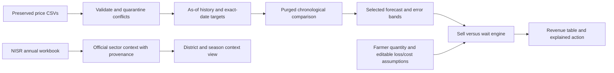
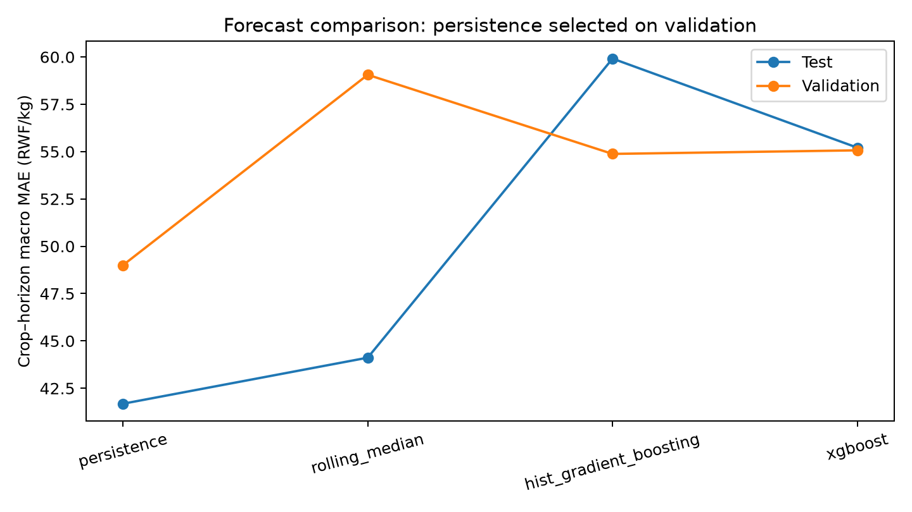
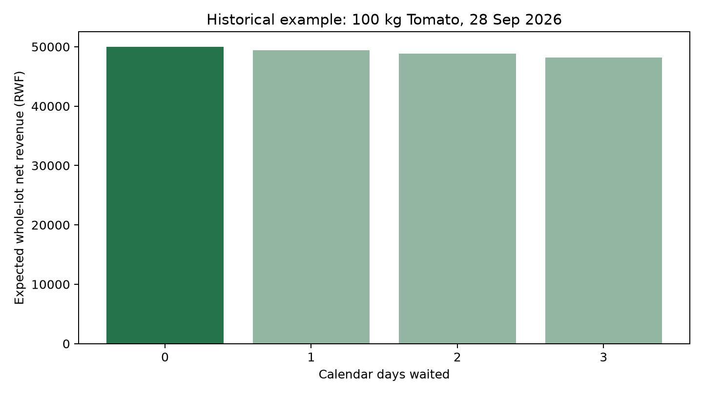

# SmartSell Rwanda

**A data-driven sell-or-store decision-support tool for Rwandan farmers.**

Should a farmer sell harvested Tomato or Carrot now, or wait up to three days? SmartSell compares expected whole-lot net revenue after assumed post-harvest deterioration (quantity loss), storage costs and other waiting costs, and shows the full calculation.

The economic question is **Will prices rise enough to compensate for quantity deterioration and storage cost?** Break-even prices show the hurdle that a forecast must exceed. A higher future price alone does not justify waiting.

Intended users are smallholder farmers, cooperatives and agricultural planners reviewing market and post-harvest tradeoffs.

Built for **NISR 2026 Big Data Hackathon — Track 1: Agricultural Productivity**. The problem connects agricultural market linkages and post-harvest management to Rwanda's productivity priorities. No government partnership, endorsement or measured farmer-income improvement is claimed.

**Public app:** Pending deployment — replace with the actual Streamlit URL.  
**Public repository:** https://github.com/Ruganji-Prince/SmartSell-Rwanda  
**Demo video:** Pending recording — instructions in [demo/README.md](demo/README.md).  
**Start here:** [one-page project summary](docs/PROJECT_SUMMARY.md), [final status](FINAL_STATUS.md), [manual inputs](REQUIRED_MANUAL_INPUTS.md).

Pre-publication review: [technical and submission audit](docs/PRE_PUBLICATION_AUDIT.md). GitHub publication is complete; deployment and submission remain pending.

Human handoff: [exact GitHub commands, Streamlit deployment and NISR submission order](docs/PUBLICATION_GUIDE.md). The final public package contains **139 files**; see the [final inventory](docs/PUBLICATION_GUIDE.md#final-public-file-inventory-139-files). The redundant development archive `sell-time-estimation-aisd-main.zip` is intentionally excluded and is not required to run or reproduce the final application.

## What the app does

1. **Home:** start with a short explanation and choose Check my crop or See market prices.
2. **Sell or Wait:** choose crop, district and market; enter quantity, illustrative daily crop loss and whole-harvest waiting costs; then press **Check the best selling time**. The result explains SELL NOW or WAIT and the price needed to cover waiting. Detailed calculations, empirical error bands and editable loss sensitivity remain available in expanders.
3. **Market Prices:** see dated observed prices, recent low/high/change summaries and a readable chart. Detailed records are optional.
4. **Agriculture Insights:** explore official historical Vegetables production, area, yield and national production use. These are sector statistics, not Tomato/Carrot-specific loss estimates.
5. **About SmartSell:** inspect How it works, Data sources, Model performance, Limitations and For researchers.

The responsive frontend uses NISR-inspired blue, navy and light-grey colours. Rwanda's current date and the dataset's latest observation are computed dynamically; local file updates invalidate the asset cache on the next refresh. No live feed or new observations are fabricated.

No login or API key is needed. **Latest available observation: 14 October 2026.** Current-date advice is withheld when no same-day price exists; data older than seven days are flagged stale. Open **Explore a past example** and enable **Use historical example** to explore dated held-out observations. The app never calls historical prices today's price.

For a working example open **Sell or Wait**, choose **Tomato → Nyarugenge → Nyabugogo**, open **Explore a past example**, enable **Use historical example**, and select **28 September 2026**. Enter 100 kg, illustrative 1% daily quantity loss and 100 RWF/day storage, then press **Check the best selling time**. The observed price is 500 RWF/kg; the measured persistence forecast supplies no price-rise signal, so SELL NOW maximizes expected net revenue. This is an explanation of a historical scenario, not current advice.

Tomorrow's break-even price is **506.06 RWF/kg**, requiring about **1.21%** uplift merely to match selling now. At whole-franc prices, 507 RWF/kg would beat that threshold: 99 retained kg × 507 − 100 = **50,093 RWF**, versus **50,000 RWF** now. A hypothetical higher price of 505 would still net only **49,895 RWF**. These examples are scenario arithmetic, not substituted forecasts or claimed income gains. Equality at break-even favors immediate sale; waiting must exceed it.

## Data and NISR's substantive role

- Original TangaBid exports identify **Esoko Rwanda** as their source: 7,076 raw rows, 6,266 retained, two crops, RWF/kg farm-gate prices. Five conflicting rows are quarantined and 805 equal-price duplicates removed. Raw files remain unchanged.
- Supplied **NISR SAS 2024 annual tables** are programmatically extracted with table/cell provenance into [data/processed/nisr/](data/processed/nisr/). They support district prioritization, seasonal production/yield/area comparisons, production-use evidence and sowing context in the app. All 30 districts are covered.
- These are **vegetable-sector context**, not Tomato/Carrot measurements. National loss shares are never treated as district losses or daily spoilage. No raw SAS microdata are available.
- Official production, yield, harvested-area and production-use evidence—including sector stored/loss shares—motivates considering storage risk. It does not numerically calibrate daily deterioration or farmer storage costs. The sensitivity view is explicitly illustrative/user-defined.
- Historical 2024 district context is attached many-to-one to 2025–2026 prices for descriptive analysis, with [a saved district crosswalk](data/processed/nisr/district_mapping.csv). No respondent-level merge or inferred transaction harvest season is used. Context is excluded from price predictors because crop-specific applicability and publication availability are unverified.

See [sources, acknowledgements and redistribution limits](docs/DATA_SOURCES.md). Price access: [TangaBid](https://tangabid.com/data-access/); official survey catalogue: [NISR](https://microdata.statistics.gov.rw/index.php/catalog).

## Architecture and decision method



`retained_kg(h) = quantity_kg × (1 − daily_loss_percent / 100)^h`  
`net_revenue(h) = predicted_price(h) × retained_kg(h) − h × (storage_cost_per_day + other_waiting_cost_per_day)`

`break_even_price(h) = (sell_now_revenue + waiting_costs(h)) / retained_kg(h)`  
`required_uplift_percent(h) = (break_even_price(h) / current_price − 1) × 100`

Break-even matches immediate sale; strictly higher future prices are needed to outperform it. The Advisor displays the required RWF/kg and percentage increases, compares forecasts against thresholds, and plots user-defined daily-loss scenarios (illustrative defaults 0%, 1%, 2%, 5%). Zero retained quantity has **no finite break-even price**; it is shown explicitly rather than divided by zero. These explanations do not alter model selection or the historical benchmark.

Compare h = 0, 1, 2, 3; ties favor the earliest sale. Costs are for the whole lot, not per kg. Illustrative daily loss defaults (Low 0.5%, Moderate 1%, High 3%, Custom 0%) are editable farmer assumptions, **not NISR measured daily deterioration**. Additional common sale costs are excluded equally from all options.

## Measured forecast results

| model | partition | macro_mae | mae | rmse | n |
| --- | --- | --- | --- | --- | --- |
| persistence | validation | 48.999 | 48.693 | 84.773 | 657 |
| rolling_median | validation | 59.058 | 58.871 | 91.845 | 657 |
| hist_gradient_boosting | validation | 54.879 | 54.602 | 79.304 | 657 |
| xgboost | validation | 55.067 | 54.807 | 78.540 | 657 |
| persistence | test | 41.682 | 41.245 | 80.477 | 314 |
| rolling_median | test | 44.116 | 43.928 | 80.658 | 314 |
| hist_gradient_boosting | test | 59.913 | 59.882 | 86.213 | 314 |
| xgboost | test | 55.209 | 55.201 | 83.484 | 314 |

Select on validation macro MAE across crop/horizon groups; evaluate test after selection. **persistence powers the local app; public deployment is pending**. Features use observations dated on or before the origin; same-day publication is assumed, not verified. Chronological 70/15/15 unique-origin-date partitions purge targets crossing boundaries; series eligibility and preprocessing use training only. Three expanding-window diagnostics are saved. No targets are interpolated. All four methods use the same eligible evaluation rows.

Test begins 2026-05-09; validation begins 2026-01-31. See [crop/horizon metrics and uncertainty](docs/MODEL_EVALUATION.md). Prior academic work explored parts of history, so these results are retrospective and require independent prospective confirmation.

## Simulated decision evaluation

| scenario | n | coverage | mean_simulated_gain_rwf | median_simulated_gain_rwf | mean_oracle_regret_rwf |
| --- | --- | --- | --- | --- | --- |
| No loss or cost | 20 | 0.080 | 0.000 | 0.000 | 500.000 |
| Illustrative 1% daily loss | 20 | 0.080 | 0.000 | 0.000 | 403.322 |
| Illustrative 3% daily loss | 20 | 0.080 | 0.000 | 0.000 | 244.851 |

Scenarios use 100 kg, zero other costs, and 0 or 100 RWF/day storage as documented in [decision evaluation](docs/DECISION_EVALUATION.md). Complete future windows cover only 20 origins (8.03% of test origins with at least one target). Flat persistence forecasts recommend immediate sale: **zero simulated gain versus selling now**, not a claimed income improvement. Hindsight regret quantifies opportunities this simple forecast misses. No claim of realized farmer income is made.




These are generated analytical figures, not app screenshots. A real screen recording remains a manual submission item.

## Run locally

Use **Python 3.14** (tested on 3.14.2). From the repository root:

Community Cloud's documented policy supports released, security-maintained Python versions, including 3.14. Package metadata and candidate Linux wheels were checked; a successful cloud build is **not yet verified**. See [the compatibility assessment](docs/PRE_PUBLICATION_AUDIT.md#14-python-and-deployment-compatibility).

```powershell
python -m venv .venv
.\.venv\Scripts\python.exe -m pip install -r requirements.txt
.\.venv\Scripts\python.exe scripts/prepare_data.py
.\.venv\Scripts\python.exe scripts/train_models.py
.\.venv\Scripts\python.exe scripts/evaluate_models.py
.\.venv\Scripts\python.exe scripts/build_submission_assets.py
.\.venv\Scripts\python.exe -m pytest -q
.\.venv\Scripts\python.exe scripts/quality_check.py
.\.venv\Scripts\python.exe -m streamlit run app.py
```

On Linux/macOS, use `.venv/bin/python` in place of the Windows interpreter path. If the Windows `python` command opens the Microsoft Store, use your installed Python 3.14 launcher to create the environment, then use its explicit relative interpreter as above. Shipped processed assets and the small selected-model JSON allow launching the app immediately after installation; training is not performed at app startup. All processing paths resolve relative to this repository. No private credentials are required.

Exact direct dependencies are pinned in [requirements.txt](requirements.txt); the full tested environment is recorded in [requirements-lock.txt](requirements-lock.txt). Deterministic seed 42, raw-data hashes, split dates, feature names and selected-model metadata are retained. Training always recreates outputs from preserved data. Optional report packaging: `python scripts/package_submission.py`.

## Repository

| Path | Purpose |
| --- | --- |
| [app.py](app.py) | Four-page public Streamlit app |
| [src/](src/) | Loading, preparation, feature, forecast, decision and NISR modules |
| [scripts/](scripts/) | Reproducible preparation, comparison, simulation, reports, QC and packaging |
| [data/raw/](data/raw/) | Unchanged farm-gate exports |
| [data/processed/](data/processed/) | Generated history, quarantines and official NISR extracts |
| [models/](models/) | Selected model metadata and lightweight artifact |
| [results/](results/) | Actual metrics, per-row predictions, simulations and audit evidence |
| [figures/](figures/) | Generated final analytical figures |
| [docs/](docs/) | Methodology, judging alignment, demo and submission instructions |
| [docs/legacy_aisd/](docs/legacy_aisd/) | Original academic README, strategy, audit, notebook and placeholder modules, preserved as history |
| [tests/](tests/) | Decision arithmetic, leakage/data checks and Streamlit interaction tests |
| [student_cards/](student_cards/) | Review instructions; no fabricated or automatically published IDs |

## Deployment, responsibility and attribution

Deploy the reviewed public GitHub repository through Streamlit Community Cloud, choosing `app.py` and Python 3.14. [Exact deployment/submission steps](docs/SUBMISSION_CHECKLIST.md) include incognito verification, <=3-minute demo and both members' eligibility evidence. The repository URL is verified; the app URL, recording and remaining account actions are pending in [REQUIRED_MANUAL_INPUTS.md](REQUIRED_MANUAL_INPUTS.md).

This is an honest working prototype for comparing assumptions. Verify buyer offers and crop conditions before acting; forecasts and loss scenarios cannot guarantee profit. Read [limitations](docs/ASSUMPTIONS_AND_LIMITATIONS.md), [methodology](docs/METHODOLOGY.md), and [judging alignment](docs/HACKATHON_JUDGING_ALIGNMENT.md).

Earlier academic materials credit **Jean Gabriel Mpuhwezimana**. Final team composition, second member and team name require confirmation; none is invented. NISR and external sources are acknowledged; the preparatory webinar's originality and IP conditions must be reviewed by the submitting team. No new open-source license or legal interpretation is added. Declare ownership and acknowledge all references truthfully in the submission.
